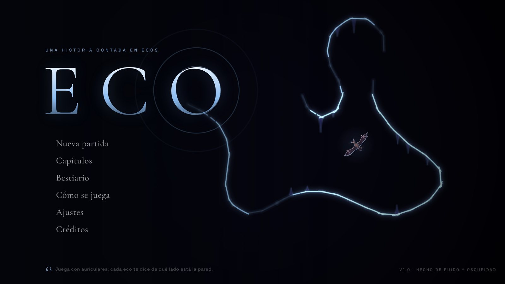
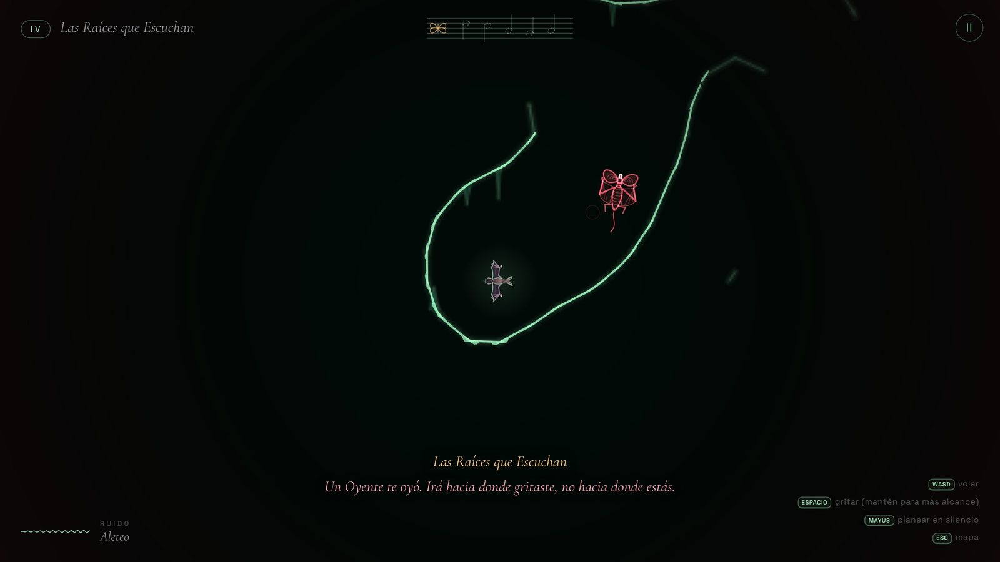
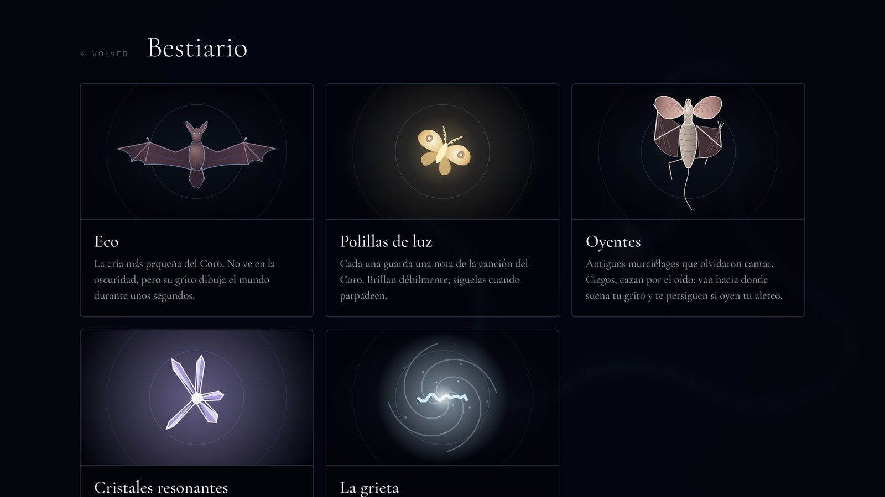

# Eco

*Una historia contada en ecos.*



Eres la cría más pequeña de un coro de murciélagos y no ves nada. Para moverte por la Hondura tienes que **gritar**: la onda recorre la cueva de verdad, rebota en la roca y cada pared que toca se ilumina unos segundos antes de volver a la oscuridad. Lo que ya oíste se queda dibujado como un mapa tenue.

El problema es que en la Hondura también viven los **Oyentes**, murciélagos antiguos y ciegos que cazan por el oído. Cada grito te enseña el camino… y les dice a ellos dónde buscarte.

Reúne las polillas de luz (cada una es una nota de la canción perdida del Coro), completa la canción y escapa por la grieta antes de que te oigan.

- 5 capítulos de historia y después la **Hondura sin fondo**, un modo infinito cada vez más difícil.
- Cuevas generadas por procedimiento: cada partida tiene su propia semilla.
- Los gráficos no usan imágenes y el sonido no usa grabaciones: todo se dibuja y se sintetiza en tiempo real.



## Jugar

**Windows 10 / 11.** Descarga `Eco-v1.0.0-Windows.zip` desde [Releases](../../releases/latest), descomprímelo y abre `Eco\Eco.exe`. Se abre en su propia ventana (usa WebView2, que ya viene con Windows). La primera vez Windows SmartScreen puede avisar porque el ejecutable no está firmado: pulsa «Más información» y luego «Ejecutar de todas formas». El progreso se guarda solo.

**Cualquier navegador.** Dentro del mismo .zip, abre `version-navegador/index.html` con doble clic (Chrome, Edge, Firefox o Safari). Desde el código también puedes generarla con `npm run build:web`. Funciona en móvil y tableta con controles táctiles si los archivos se sirven desde una web.

Juega con auriculares: los ecos suenan del lado de la pared que los devolvió.

## Controles

| Acción | Teclado y ratón | Mando | Táctil |
|---|---|---|---|
| Volar | WASD o flechas | stick izquierdo / cruceta | joystick |
| Gritar | mantén Espacio o clic y suelta | A | botón «Grito» |
| Planear en silencio | Mayús | gatillos o botones superiores | botón «Planear» |
| Pausa y mapa | Esc | Start | botón de pausa |
| Pantalla completa | F11 | | |

## Cómo se juega

- **Un grito largo ve más lejos, pero también se oye más lejos.** Un chasquido corto es casi seguro.
- **Los Oyentes van hacia donde sonó el grito, no hacia donde estás.** Grita y aléjate.
- **Si oyen tu aleteo de cerca, te persiguen.** Volando eres más rápido que ellos, pero haces ruido; planeando no te oyen, pero avanzas despacio. Escapa primero y planea después.
- **Los cristales resonantes repiten tu grito** desde donde están: sirven para ver lejos o para mandar a los Oyentes a otra parte.
- Las ondas rojas en el suelo son los pasos de los Oyentes.

| Capítulo | Nombre | |
|---|---|---|
| I | La Boca | donde la oscuridad deja de responder |
| II | Bosque de Agujas | las piedras cuelgan como dientes |
| III | El Lago Mudo | el agua se tragó la primera nota |
| IV | Las Raíces que Escuchan | el bosque de arriba también tiene oídos |
| V | El Corazón de la Hondura | donde termina la canción |
| ∞ | Hondura sin fondo | más abajo de lo que cuenta ninguna historia |

## Cómo está hecho

- **Cuevas.** Un autómata celular crea las cámaras, un árbol de expansión mínima con algunos bucles las une con túneles y después todo se convierte en un campo de densidad suave. Las paredes son el contorno de ese campo (marching squares interpolado), así que no hay bloques. La entrada, las polillas, los Oyentes y la salida se colocan por distancia real de pasillo, y un bot recorre cada capítulo en las pruebas para garantizar que siempre se puede terminar.
- **Ecolocalización.** Cada grito lanza 320 rayos que avanzan por el campo de densidad. El frente de onda viaja a 24 casillas por segundo, enciende las paredes al tocarlas y el polvo suspendido al pasar. Los ecos se apagan en 3,6 segundos y lo tocado se guarda en un lienzo de memoria que es el mapa de la pausa.
- **Oyentes.** Duermen, deambulan, escuchan, investigan y cazan. El sonido les llega por los pasillos (búsqueda en anchura) y nunca a través de la roca.
- **Sonido.** WebAudio puro: el chirrido y sus ecos se espacializan por sectores (retardo y paneo según la distancia a la pared), con reverberación por convolución. Las campanas y los pads de la canción, las respiraciones de los Oyentes, el latido, el viento y las gotas se generan en el momento.
- **Gráficos.** Canvas 2D con una capa de brillo a media resolución, viñeta, grano y latido de peligro. Los modelos (Eco, los Oyentes, las polillas, los cristales y la grieta) son funciones de dibujo con animación propia. La calidad se ajusta sola si el equipo va justo.

  

- **Ejecutable.** Un lanzador en Go incrusta el juego, lo sirve solo en `127.0.0.1` y lo abre en una ventana WebView2. Usa un puerto fijo para que el guardado persista entre partidas. Si WebView2 faltara, abre el juego en el navegador.

## Código

```
index.html, styles.css   pantallas e interfaz
src/main.js              estados del juego, historia, menús y bucle principal
src/game.js              simulación: jugador, gritos, Oyentes, polillas, cristales
src/cave.js              generación de cuevas
src/geometry.js          campo de densidad, rayos, colisiones y caminos
src/render.js            dibujo de la cueva, ecos, efectos y mapa
src/models.js            modelos dibujados por código
src/audio.js             motor de sonido sintetizado
src/input.js             teclado, ratón, mando y táctil
src/story.js             textos, capítulos y bestiario
src/ui.js, src/save.js   pentagrama, retratos, avisos y guardado
tests/                   pruebas del motor y partidas completas con un bot
tools/                   servidor local y empaquetado web
launcher/                Eco.exe (Go + WebView2)
dev/                     hojas de modelos y generador del icono
docs/capturas/           imágenes de este README
```

## Desarrollo

Necesitas Node 18 o superior. Para el ejecutable, Go 1.22 o superior (compila para Windows desde cualquier sistema).

```bash
npm install
npm start            # http://127.0.0.1:8080
npm test             # 27 pruebas, incluidas partidas completas de los 5 capítulos
npm run build:web    # dist/web: versión que funciona abriendo index.html
npm run build:exe    # launcher/dist/Eco.exe
npm run package      # release/: el .zip para Windows y el .zip del código
npm run build:artifact  # dist/artifact/eco.html: todo el juego en un solo archivo
```

Con `?seed=1234` en la dirección, la siguiente partida nueva usa esa semilla.

## Licencias de terceros

- Fuentes Cormorant Garamond y Space Grotesk: SIL Open Font License 1.1 (`assets/fonts`).
- Ejecutable: go-webview2 (MIT), go-winloader (ISC), Go y golang.org/x/sys (BSD) y WebView2Loader.dll de Microsoft (BSD). Los textos van en `licencias/` dentro del .zip.

El código del juego todavía no tiene licencia elegida.
